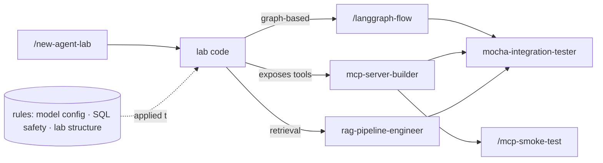

# Claude Code setup for the course labs

This folder teaches Claude Code how this course builds agentic apps. Every **skill**, **rule** and **sub-agent** here comes from patterns that already exist in `labs/`. Claude follows the course's conventions instead of generic defaults.

```
.claude/            (repo root: hightech_course_dev_ai/.claude)
├── README.md                       ← you are here
├── agents/                         ← sub-agents (specialists Claude can delegate to)
│   ├── mocha-integration-tester.md
│   ├── mcp-server-builder.md
│   └── rag-pipeline-engineer.md
├── rules/                          ← always-on / path-scoped instructions
│   ├── llm-model-config.md
│   ├── llm-sql-safety.md
│   └── lab-structure-and-docs.md
└── skills/                         ← step-by-step playbooks, invoked on demand or via /name
    ├── new-agent-lab/SKILL.md
    ├── langgraph-flow/SKILL.md
    └── mcp-smoke-test/
        ├── SKILL.md
        └── scripts/mcp-call.sh
```

> Lives at the repo root, so it is picked up when you run `claude` from `hightech_course_dev_ai/`. Lab paths in these files are relative to the root (`labs/lab_NN_.../`).

---

## Which one is which?

| Kind | What it is | When it runs | Analogy |
|------|-----------|--------------|---------|
| **Rule** | Short "always do / never do" guidance | Loaded automatically: always, or when Claude touches files matching `paths:` | Team coding standard |
| **Skill** | A playbook for one task, with templates and scripts | When the task matches its `description`, or when you type `/skill-name` | Runbook / recipe |
| **Sub-agent** | A specialist with its own context window and tool set | When Claude delegates, or when you ask ("use the mocha-integration-tester agent") | Teammate you hand a ticket to |

---

## 🤖 Sub-agents

### 1. `mocha-integration-tester`
**Target:** Get real integration tests for every lab server.
- Writes **Mocha** tests that start the Express app on an ephemeral port and call it over HTTP with **axios**, the same way `lab_05` and `lab_06` do.
- Handles non-deterministic LLM output by checking **shape and invariants** (types, enums, non-empty, sorted scores), never exact text.
- **Skips** instead of failing when `OPENROUTER_API_KEY` or the DB is missing, so `npm test` stays green on a fresh clone.
- Covers unhappy paths (400 validation, 401 on `/mcp`, rejected SQL) and MCP JSON-RPC (`initialize`, `tools/list`, `tools/call`).
- Runs the tests and reports the real results.

**Try:** *"Use mocha-integration-tester to add tests for lab_16's POST /query."*

### 2. `mcp-server-builder`
**Target:** Build MCP servers and clients that are correct, typed and secure (labs 10–13).
- Factory + transport split (`create-*-server.js` + `index.js`), and a **stateless** Streamable HTTP transport by default.
- Every tool gets a Zod `inputSchema` **and** `outputSchema`, with descriptions written for the model.
- Errors come back as `isError` results. JWT Bearer auth like lab 12, and no hardcoded tokens.
- Clients load tools at runtime through `@langchain/mcp-adapters`.

**Try:** *"Use mcp-server-builder to add a `delete_ticket` tool to lab_12 with confirmation."*

### 3. `rag-pipeline-engineer`
**Target:** Make retrieval grounded, debuggable and measurable (labs 09, 14, 15, 16, 18).
- Keeps indexing scripts separate from querying, structure-aware chunking with metadata, and **recall wide → rerank**.
- Schema-RAG → SQL → guard → execute → answer, as in lab 16 / 09_c.
- A fixed **debugging order**: DB up → index populated → raw candidates → rerank → prompt. You find *which stage* broke instead of guessing.

**Try:** *"Use rag-pipeline-engineer: lab_15 search for 'red car' returns nothing useful."*

---

## 📏 Rules

### 1. `llm-model-config.md`
**Scope:** `*.js`, `*.ts`, `.env.example`.
**Target:** One consistent and cheap way to talk to models.
- A single model factory per lab (`model.js` / `lib/llm.js`). Model ids come from env vars.
- Always cap `maxTokens`, because OpenRouter otherwise reserves the full context. Temperature 0 for routers, SQL and extraction.
- Keys only from `.env`, and every new var goes into `.env.example`. Don't mix LangChain `0.3` and `1.x` in one package.

### 2. `llm-sql-safety.md`
**Scope:** `sql-*`, `db-executor.*`, `db/**`, `guardrails/**`, `*.sql`.
**Target:** Treat model-written SQL as untrusted input.
- AST validation with `node-sql-parser` (see `labs/lab_09_c/server/src/guardrails/sql-guard.ts`), not regex.
- One `SELECT` only, allow-listed tables, denied sensitive columns, blocked `pg_*` and `dblink`, a forced `LIMIT`.
- Defense in depth: a `READ ONLY` transaction, `statement_timeout`, and a SELECT-only role. Hand-written SQL is always parameterized.

### 3. `lab-structure-and-docs.md`
**Scope:** any file under `labs/**`.
**Target:** Every lab stays a self-contained, runnable lesson.
- Standard folder layout (`agents/`, `lib/`, `scripts/`, `test/`, `client/`), `lab_NN_` numbering, and letter suffixes for variants.
- The readme is required: goal, Mermaid flow, setup, run, API, env vars, exercises. Kept in sync with code changes.
- No port collisions, no secrets in git, and comments that explain *why* for learners.

---

## 🧰 Skills

### 1. `/new-agent-lab`
**Target:** Start a new lab in a minute, already following the rules above.
Scaffolds the server (`index.js` exporting `app`, `lib/llm.js`, `agents/`), `.env.example`, a Mocha test, and optionally a Vite client (`--client`), pgvector docker-compose (`--db`) or an MCP server (`--mcp`). It writes the readme template with a Mermaid flow and exercises, then installs, tests and runs it.

**Try:** `/new-agent-lab email_triage_agent --client` or `/new-agent-lab --from lab_09_c hardened_router`

### 2. `/langgraph-flow`
**Target:** Build LangGraph pipelines that are correct and documented (labs 17–18).
State first (`Annotation.Root` with reducers), small pure nodes, **one conditional edge per decision point**, and loops with a hard `MAX_ITERATIONS` stop. Then it regenerates `langgraph-flow.mmd` and the readme diagram from the code. It also points out the duplicated conditional edges in `lab_17`'s orchestrator.

**Try:** *"Add a reviewer node to lab_17 that sends the draft back to the writer at most 2 times."*

### 3. `/mcp-smoke-test`
**Target:** Check an MCP server in seconds, without a client app.
Runs `scripts/mcp-call.sh`, which sends `initialize`, `tools/list` and, if you name a tool, `tools/call` as raw JSON-RPC (with an optional JWT). It then summarises the tools and maps common failures (406, 401, missing tool, hang) to their cause.

**Try:** `/mcp-smoke-test http://localhost:3200/mcp get_question '{"topicId":"mcp"}'`

---

## How they work together


