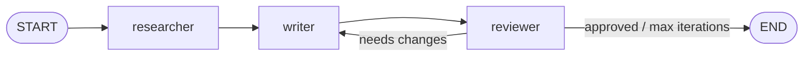

# Build or change a LangGraph flow

Reference: `labs/lab_17_langgraph_researcher_writer/graph/orchestrator.js` (researcher → writer) and `labs/lab_18_langgraph_image_rag` (separate indexing and search graphs, plus `langgraph-flow.mmd`).

## 1. Model the state first

Write the `Annotation.Root` before any node. Each field has one owner node that writes it. Use a reducer for accumulating fields:

```js
const State = Annotation.Root({
  userQuery:     Annotation(),
  researchNotes: Annotation(),
  draft:         Annotation(),
  feedback:      Annotation(),
  iterations:    Annotation({ reducer: (a, b) => a + b, default: () => 0 }),
  messages:      Annotation({ reducer: (a, b) => a.concat(b), default: () => [] }),
});
```

## 2. Nodes are small and pure

- One node = one responsibility. It wraps an agent from `agents/` or a plain function (embed, retrieve, rerank).
- A node returns **only the fields it changes** (a partial state), and never mutates `state`.
- Name nodes with verbs in camelCase (`embedQuery`, `retrieveCandidates`, `reviewDraft`).

## 3. Edges

- Linear: `.addEdge(START, "a").addEdge("a", "b").addEdge("b", END)`.
- Branching: one `addConditionalEdges(source, routerFn, pathMap)` per decision point, where `routerFn(state)` returns a key of `pathMap`. **Don't mix** a plain `addEdge` and a conditional edge from the same source. That is the bug in the current `lab_17` orchestrator, which registers both and duplicates the conditionals; fix it if you're touching that file.
- Loops **must** have a hard stop: `state.iterations >= MAX_ITERATIONS ? END : "writer"`. Also pass `{ recursionLimit }` to `invoke`.

## 4. Compile and expose

`export function createGraph(deps)` returns `graph.compile()`. Inject the API key and model factory as `deps` so tests can stub them. The HTTP route calls `await graph.invoke({ userQuery })` and returns the final fields (plus `iterations` for observability).

## 5. Keep the diagram in sync (required)

Regenerate `langgraph-flow.mmd` from the code, never from memory:



Label conditional edges with the condition. Embed the same block under `## Flow` in the lab readme. Optionally print the compiled graph's own view with `(await app.getGraphAsync()).drawMermaid()` and compare.

## 6. Verify

Run the graph once with a sample input and print each node's output (`for await (const chunk of await app.stream(input, { streamMode: "updates" }))`). Confirm the loop ends. Suggest an integration test to `mocha-integration-tester` that asserts the final state shape and `iterations <= MAX_ITERATIONS`.
