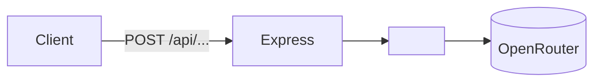

# Scaffold a new agent lab

Run from the repo root. Follow `.claude/rules/lab-structure-and-docs.md` and `.claude/rules/llm-model-config.md`.

## 1. Decide name and number

- `ls labs/` and take the next free `lab_NN_`. With `--from lab_NN`, use a letter suffix instead (`lab_09_c` → `lab_09_d`).
- Pick ports that don't clash: `grep -rhoE "localhost:[0-9]{4}" labs/lab_*/readme.md labs/lab_*/README.md | sort -u`.

## 2. Ask only what you can't infer

Which agent pattern? Pick one, defaulting to **single agent**:
- **single agent**: `createAgent` + a system prompt (labs 03–05)
- **two-agent pipeline**: extractor → writer (lab 06)
- **agent + tools**: Zod tools, optionally Tavily (lab 07)
- **router + agents-as-tools** (lab 16)
- **LangGraph**: use the `langgraph-flow` skill after scaffolding

## 3. Generate files

```
lab_NN_<name>/
  readme.md
  server/   (or lab root if no client)
    package.json        # type: module; scripts: start, dev (nodemon), test (mocha)
    .env.example        # OPENROUTER_API_KEY=, OPENROUTER_MODEL=openai/gpt-4o-mini, LLM_MAX_TOKENS=1024, PORT=
    index.js            # export const app; listen only if run directly
    lib/llm.js          # createChatModel(), copied from labs/lab_09_b/server/lib/llm.js
    agents/<name>-agent.js
    test/api.integration.test.js
  client/ (--client)    # Vite React, proxy /api → server port
  docker-compose.yml    # (--db) pgvector/pgvector:pg16 + pgAdmin, copied from labs/lab_14_image_text_search_pgvector
  schema.sql            # (--db)
  mcp-server/ (--mcp)   # copy the labs/lab_10_quiz_mcp_server factory + stateless transport layout
```

The `index.js` "listen only if run directly" guard:
```js
import { fileURLToPath } from "node:url";
if (process.argv[1] === fileURLToPath(import.meta.url)) {
  app.listen(PORT, () => console.log(`Server on http://localhost:${PORT}`));
}
```

Start the test from the `lab_05` integration test (skips with no key, port 0, axios).

## 4. Readme template

~~~markdown
# Lab NN: <Title>

<1–3 sentences: what the learner builds and which concept it teaches>

## Flow


## Setup
## Run
## API
## Environment variables
## Exercises   <!-- 2–4 small follow-up tasks for learners -->
~~~

## 5. Verify

`npm install`, `npm test` (it should pass, or skip if there's no key), and `npm start`. Hit the endpoint once with curl. Report the folder tree and the commands.
